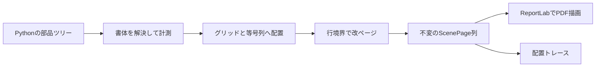

# アーキテクチャ

GridLayoutPdfは、計算値を表示部品へ渡すところからPDF出力までを扱う。構造計算・入力値の評価・数値の丸めは利用アプリの責務とする。

## 処理の境界

部品の位置は左上原点のptで表す。グリッドは外側の位置・幅・占有行数を決め、文字の送りや数式内部の寸法は書体から計測する。PDFの左下原点へ変換する処理は描画器に集約する。

## モジュール

| モジュール | 責務 |
|---|---|
| geometry / profiles | 有限な幾何、グリッド境界、実測／生成した用紙、本文行範囲 |
| styles / fonts | 文字設定、明示的な書体登録、NFC、欠字検査、送り幅と実字形境界 |
| scene / bounds | 不変の描画命令とページ、線幅・実字形を含む共通境界 |
| math | 分数・根号・添字・括弧等の局所計測。MathBoxは基線と数式軸を保持 |
| text / blocks | 行組、基本禁則、上限付き字間、段落・見出し・空白 |
| equations | 意味上の折り返し、等号・結果・単位の共有アンカー、MathBlock |
| layout | 共通計測結果、分割、prefix再掲、部品内境界検証 |
| containers | 縦積み・横並び・分割禁止・明示位置の指示 |
| rotation | 局所グリッドで子を計測し、90度回転した既存primitiveと変換metadataへ確定 |
| tables | セル配置と結合検証、整数行高、分割禁止行群、ヘッダー |
| figures | 図枠・矢印・ラベル、画像の読込みと内容固定 |
| document | ページフロー、見出し連鎖、用紙切替、ページ装飾 |
| diagnostics | 確定したページの配置・文字・実境界をJSONへ変換 |
| renderers/reportlab | 全ページの事前検査、描画状態の分離、PDF座標変換、一時ファイル出力 |

## 計測と分割

通常部品は`measure(LayoutContext, available_width)`でMeasuredBlockを返す。LayoutContextは書体・用紙・ReportStyleを渡し、基線を整数行だけ下げる共通処理を持つ。

LayoutPartは分割しない縦方向の単位で、正の占有行数・相対描画命令・不変metadataを持つ。段落では表示1行、数式では折り返し後の1行、表ではrowspanで接続した行群、図では全体が1partになる。

MeasuredBlockはprefixと本文partsを持つ。splitは本文の合法な境界だけで分け、prefixを両側へ再掲する。段落のmin_first/min_lastは表示part数を数え、物理グリッド行数やprefixを数えない。分割結果はどちらも本文を1part以上含み、再分割でも制約を保持する。

Stackは通常フローで子へ展開する。ColumnsやKeepTogetherの中で計測すると全体が原子的になる。原子的な容器でも子の位置とローカルmetadataを残し、等号アンカーをトレースできる。

QuarterTurnは原点0の局所PageProfileで子を計測し、Text/Line/Polyline/Rectangleを剛体回転して一つのLayoutPartへ確定する。再帰的な変換sceneノードは増やさない。Textは0〜3のquarter_turnsと既定0のshear_xを持ち、共通boundsは基線周りの実字形四隅を傾斜してから回転し、描画器も同じ順のPDF文字行列で扱う。QuarterTurnは文字の傾斜を保持する。子metadataは局所座標のまま保存し、local_to_part行列と累積part位置を明示する。外側の高さだけ整数行へ丸め、内容や文字サイズは変えない。

## 数式の配置

MathBoxは送りと実字形を含む幅、ascent/descent、数式軸、相対命令を返す。分数・添字等はサイズから局所配置を決め、必要な数式全体の寸法を外側へ返す。外側の部品が基線と占有行数をグリッドへ合わせる。

EquationGroupはラベル・左辺・関係記号・結果・単位を先に計測してアンカーを確定し、残り幅で右辺を折り返す。ページ内の位置に応じてアンカーを変更する循環は作らない。同じprofile・幅での分割ではアンカーを保持し、profile・利用幅に応じて再計測する。

## 書体・描画・失敗時の挙動

送り幅と実字形境界は別に保持する。特に斜体的な張り出しや下降文字を、文字列の送り幅だけで枠内と判定しない。グリフの存在を幅計測と独立に検査し、欠字を代替字形で黙って出力しない。

画像は計測時に静止PNG/JPEGを検証し、方向・色・透明度を正規化したbytesを描画命令へ保持する。描画時は元のファイルを読み直さない。

描画器は全ページと画像を検査してから同じ出力先ディレクトリの一時ファイルへ描き、保存完了後に置き換える。ページごとの用紙サイズ、フォント、文字送り、線属性を明示設定する。描画状態が前の部品・ページから漏れないようにする。

計測・改ページの幅不足は対象のpathと必要量を付けて診断する。空ページでも配置が進まない場合にエラーで停止し、無限に改ページしない。ページ装飾は予約枠へ後描画し、総ページ数の変化が本文の再配置を呼ばない設計とする。
